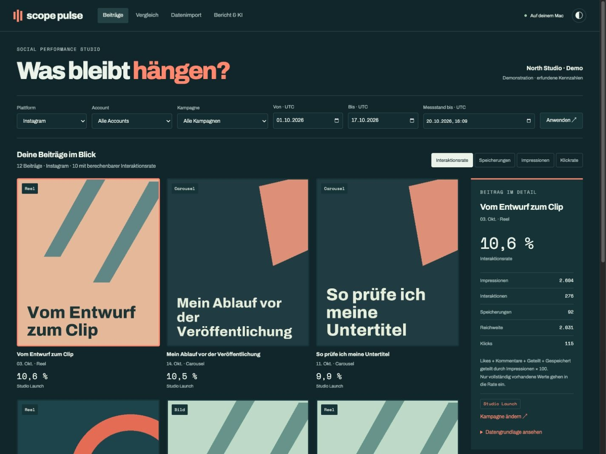
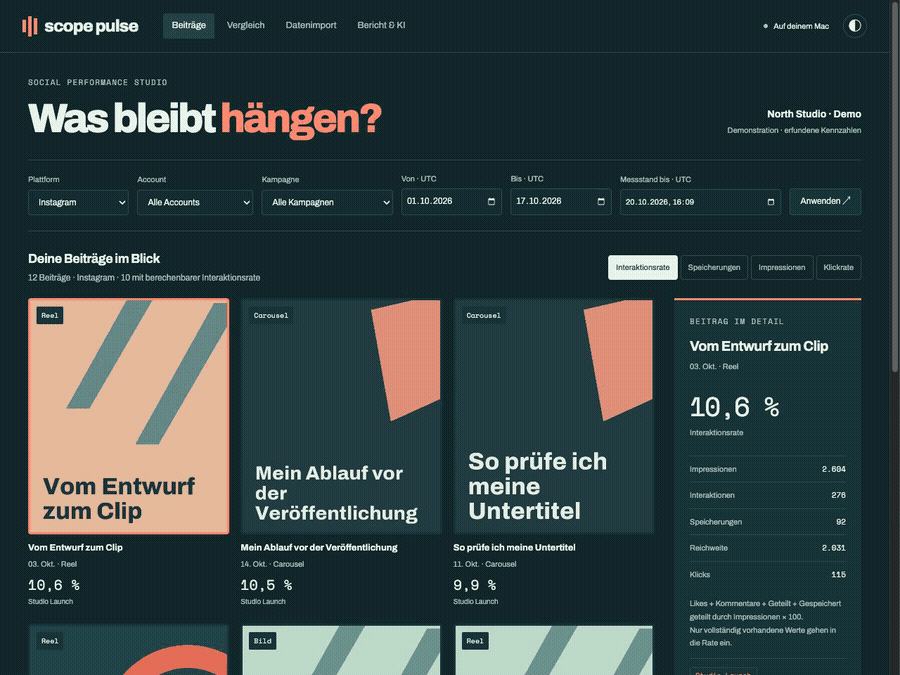
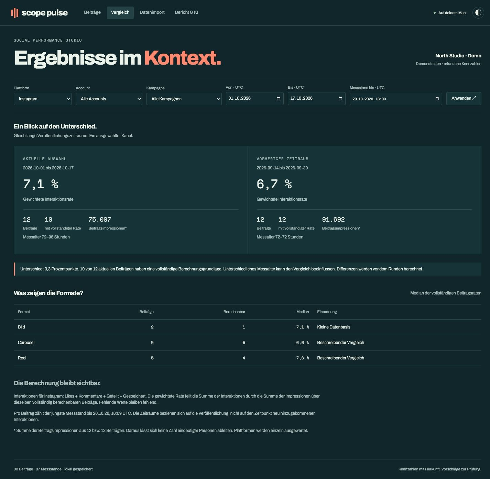

# Scope Pulse

**English** · [Deutsch](README.de.md)

### What did people come back to?

Social media reports often stop at a total. I wanted to see the posts behind it: which ones were saved, how their results were calculated, and whether the comparison was fair.

Scope Pulse is a working local application for importing post metrics, reviewing campaigns and preparing a report. A local language model proposes follow-up tests from calculated findings. The suggestions stay editable until they have been reviewed.

*The screenshots use a fictional studio, illustrative title cards and invented metrics. They show the application running locally.*

[Watch the screen recording](assets/pulse-walkthrough.mp4) · [Open the sample PDF](assets/sample-report.pdf) · [Read the checks](docs/VERIFICATION.md)

## From a CSV to a decision worth testing

**Start with the individual post.** Switch between interaction rate, saves, impressions and click rate. The detail panel shows the inputs, capture time and source import for the selected post.

**Keep the comparison honest.** A missing value stays missing. A later cumulative measurement replaces the earlier measurement for that analysis; the two are never added together. Periods are equally long, platforms stay separate, and the age of the measurements remains visible.

**Turn a finding into a next step.** Qwen3 4B selects from findings computed by the application and drafts suggestions on the same Mac. The factual sentences remain fixed. Suggestions can be edited, and only a reviewed draft matching the current data can enter a report.

**Keep the report as it was.** PDF and CSV exports preserve the selected data, calculation basis and review text. Later imports do not rewrite an existing report.

*A 27-second recording of post selection, comparison, import validation and report generation. The reviewed suggestions were edited during testing.*

## A different visual direction

Petrol, coral and pale sage give Pulse the feel of a small editorial studio. Large post cards lead the page. Archivo carries the headings; Space Mono distinguishes measurements and dates. A light view and a narrower layout are included.

## What is implemented

CSV column mapping, preview and validation; duplicate and conflict checks; campaign assignment; account and date filters; cumulative observations in SQLite; descriptive metrics; local model drafts; reviewed PDF and CSV exports.

The private application uses Python, SQLite, JavaScript, ReportLab, Ollama and Qwen3 4B. I developed it with Codex, with particular attention to the workflow, visual design and what the numbers can reasonably support. [Implementation decisions and my role →](docs/CASE_STUDY.md)

**Verified locally on 20 October 2026:** 37 automated tests passed. The browser workflow was exercised with 36 synthetic posts and 37 measurements. Final model runs covered Instagram and LinkedIn; the five-page sample report was rendered and visually inspected. [Evidence and limits →](docs/VERIFICATION.md)

This version imports CSV files. It does not connect to social platform APIs, publish posts or claim to predict campaign performance. Its metric definitions are documented application rules and may differ from a platform's own report.

**This repository contains the presentation only.** Source code, database, models, original imports and raw model responses remain private. The PDF is a selected presentation output containing synthetic data. No open-source license is granted for the original portfolio material. [Rights](RIGHTS.md) · [Third-party notices](THIRD_PARTY_NOTICES.md)
