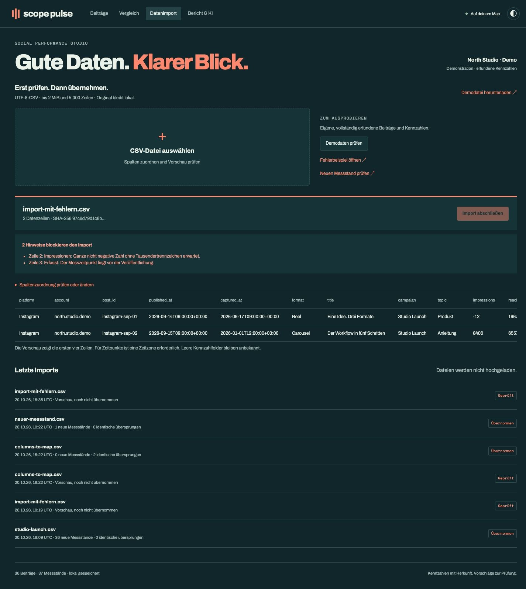
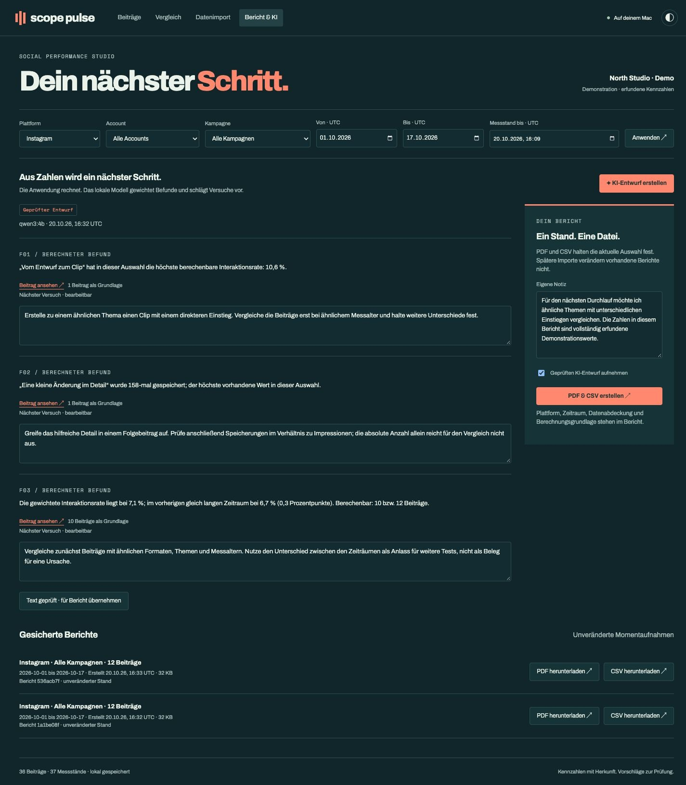
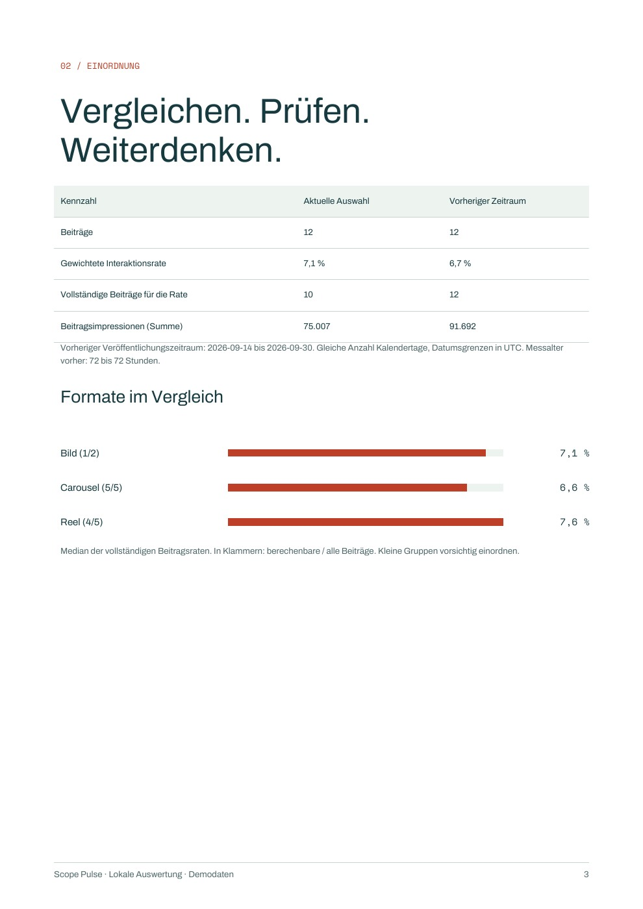
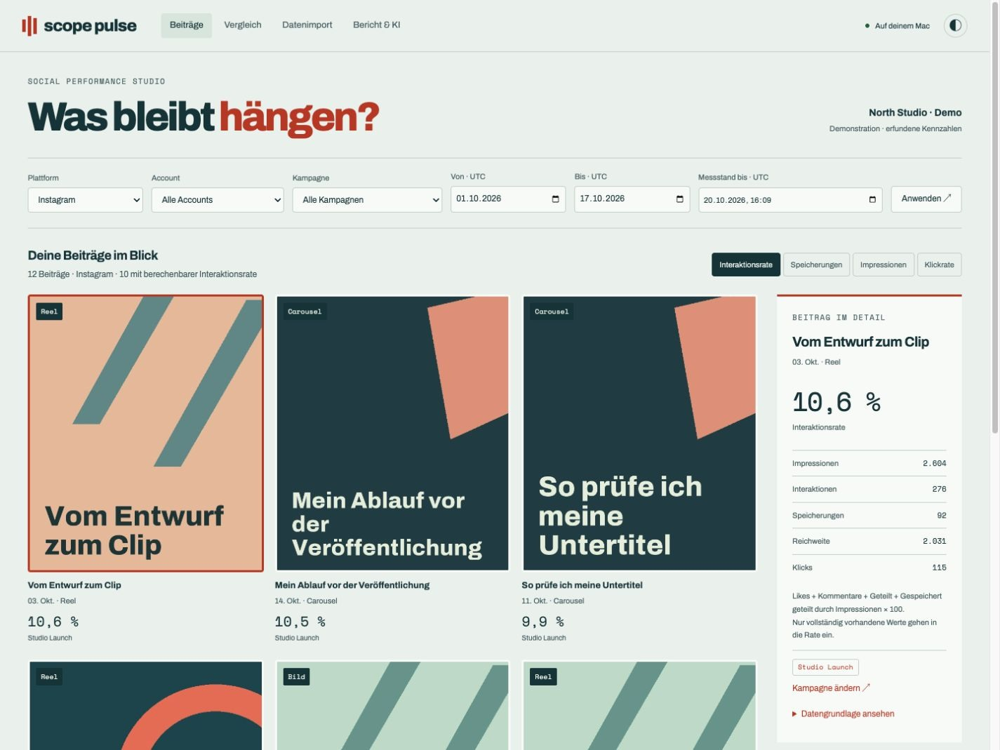
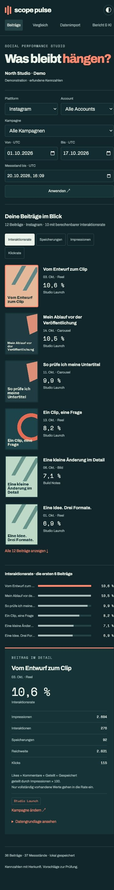

# Warum ich Scope Pulse gebaut habe

[English](CASE_STUDY.md) · [Projekt](../README.de.md)

Nach der Veröffentlichungsautomation und der Verarbeitung kurzer Videos wollte ich mich mit der nächsten Frage beschäftigen: Was lässt sich aus den bereits veröffentlichten Beiträgen lernen?

Die Schwierigkeit liegt für mich weniger im Zeichnen eines Diagramms als in der Auswahl seiner Daten. Zwei Exporte können kumulative Werte desselben Beitrags enthalten. Ein leeres Feld kann „nicht verfügbar“ bedeuten. Ein neuer Beitrag hatte weniger Zeit, Interaktionen zu sammeln. Pulse macht diese Unterschiede sichtbar.

## Entscheidungen zum Arbeitsablauf

Ein Import beginnt mit einer Vorschau. Unbekannte Spaltenüberschriften lassen sich zuordnen, Zeilen und Fehler vor dem Speichern prüfen. Identische Messstände werden übersprungen. Widersprüche blockieren den gesamten Import, auch wenn sich die Datenbank zwischen Vorschau und Bestätigung geändert hat. Die ursprüngliche CSV bleibt privat und unverändert erhalten.

Beitrag, Messstand und Kampagnenzuordnung sind getrennt gespeichert. Dadurch lässt sich eine Zuordnung berichtigen, ohne die Importdatei umzuschreiben oder frühere Messungen zu verlieren. Der ausgewählte Stichtag bestimmt, welcher Messstand in die Auswertung eingeht.

Bei der gewichteten Interaktionsrate stammen Zähler und Nenner aus denselben berechenbaren Beiträgen. Für Instagram zählt die Anwendung Likes, Kommentare, geteilte Inhalte und Speicherungen. Für LinkedIn und X sind es Likes, Kommentare und geteilte Inhalte. Das sind die Importregeln der Anwendung; eine Plattform kann ihre eigene Rate anders definieren.

Der vorherige Zeitraum enthält gleich viele Veröffentlichungstage. Messalter und fehlende Werte bleiben sichtbar, denn gleich lange Kalenderzeiträume machen zwei Beitragsgruppen noch nicht vergleichbar. Formatmediane beschreiben die vorhandenen Daten; kleine Gruppen werden benannt.

## Wobei das lokale Modell hilft

Die Anwendung übergibt berechnete Befunde, zugehörige Beitragsverweise und zulässige Arten von Folgeversuchen. Qwen wählt Befunde aus und formuliert nächste Schritte. Neben jedem bearbeitbaren Vorschlag steht die unveränderte, berechnete Aussage.

Während der Entwicklung sind mehrere Modellantworten an der Prüfung gescheitert: durch doppelte Bezüge, eine zu große Auswahl oder eine unvollständige Antwort. Daraus entstanden keine akzeptierten Entwürfe. Ich habe die Ausgabestruktur enger gefasst und die abgelehnten Versuche zur Prüfung privat aufbewahrt. Die abschließenden Durchläufe für Instagram und LinkedIn lieferten akzeptierte Entwürfe.

„Akzeptiert“ bedeutet hier, dass Struktur, Bezüge und geprüfte Zahlenangaben die Validierung bestanden haben. Die inhaltliche Einordnung ist damit noch nicht bestätigt. Die Vorschläge im Beispiel habe ich überarbeitet, damit sie keine Ursache nahelegen und brauchbare Vergleiche vorschlagen. Der Bericht enthält den geprüften Text.

## Die Gestaltung

Beim Wechsel der Kennzahl sollten die Beiträge erkennbar bleiben. Deshalb stehen große Karten im Mittelpunkt, daneben eine eigene Detailansicht. Die Berechnung bleibt damit nah am Inhalt. Petrol und Koralle ziehen sich durch Vergleich und Import; das PDF hat einen hellen Hintergrund zum Lesen und Drucken.

Auf schmalen Bildschirmen rückt die Detailansicht unter die Karten. Der Hinweis auf die Demodaten bleibt sichtbar. Zusätzlich gibt es eine helle Darstellung.

Helle Darstellung und mobiles Layout ansehen

## Mein Anteil und der erreichte Stand

Ich habe Produktrichtung, Gestaltung und Prüfablauf vorgegeben und die Umsetzung mit Codex entwickelt und überarbeitet. KI-Unterstützung kam bei Programmierung, Tests, Browserprüfungen und Dokumentation zum Einsatz. Das lokale Qwen-Modell ist eine Funktion der Anwendung; es berechnet die gezeigten Kennzahlen nicht.

Entstanden ist eine lokale Portfolio-Anwendung, die mit erfundenen Daten geprüft wurde. Sie ist kein bereitgestellter Analysedienst und keine Untersuchung echter Kampagnenleistung. Mehrbenutzerbetrieb, direkte Plattformanbindungen und eine breitere Modellauswertung würden zusätzliche Arbeit erfordern.

[Prüfbericht](VERIFICATION.md#deutsch) · [Beispielbericht](../assets/sample-report.pdf)
